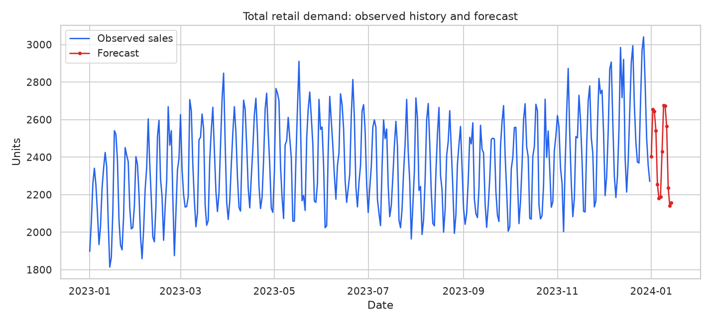
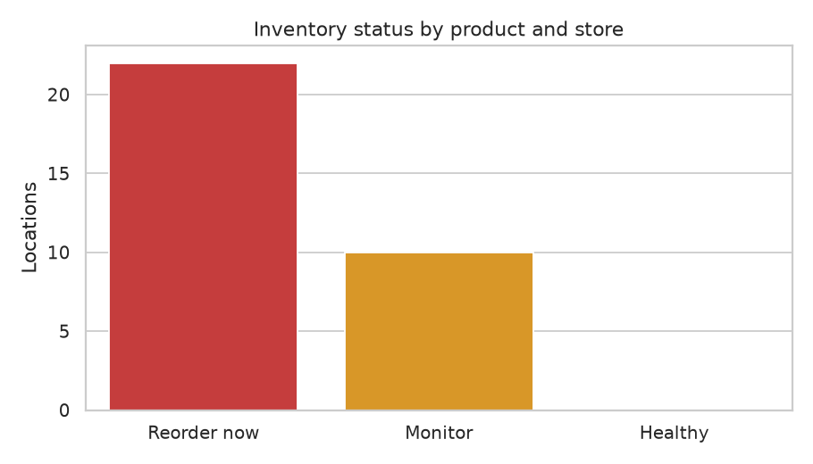

# Retail Sales Forecasting & Inventory Optimization System

An end-to-end, recruiter-friendly data science portfolio project that turns simulated retail transactions into a demand forecast and practical replenishment recommendations. The repository is designed to be easy to run locally, easy to explain in an interview, and transparent about where assumptions enter the model.

## Overview

The project simulates daily sales for multiple products and stores, cleans and enriches the data, trains a time-aware demand forecasting model, and translates the forecast into reorder points, safety stock, target stock, and recommended order quantities. The Streamlit dashboard presents the outputs as a small decision-support cockpit rather than as a model-only notebook.

The default run is deterministic (`random_seed=42`), so the same command produces a comparable dataset and set of artifacts. No credentials, cloud services, or external data downloads are required.

## Business problem

Retail teams need to balance two expensive outcomes:

- **Stockouts:** lost sales and a poor customer experience when demand exceeds available inventory.
- **Overstock:** cash tied up in products that are not selling quickly enough.

The business question is: **given observed sales history, what demand should each product-store location plan for next, and which locations need replenishment now?**

This project answers that question with a reproducible baseline workflow:

1. Build realistic but explicitly synthetic sales history.
2. Forecast daily units for a short future horizon.
3. Combine forecast demand, lead time, demand variability, and service level into inventory actions.
4. Surface the actions in a dashboard that a non-technical stakeholder can scan quickly.

## Selected stack

| Layer | Technology | Why it was selected |
| --- | --- | --- |
| Language | Python 3.10+ | Broad data science ecosystem and readable implementation |
| Data preparation | pandas, NumPy | Tabular transformations, validation, and deterministic simulation |
| Forecasting | scikit-learn Random Forest | Strong transparent baseline for mixed calendar and categorical features |
| Reporting | matplotlib, seaborn | Reproducible static charts for saved artifacts |
| Portfolio UI | Streamlit | Fast, accessible local dashboard with no frontend build step |
| Quality checks | pytest | Regression coverage for simulation, feature engineering, forecasting, inventory math, and pipeline output |

## Architecture

```text
PipelineConfig
      │
      ▼
Synthetic sales simulator ──► cleaning ──► lag / rolling / calendar features
                                                    │
                                                    ▼
                                      chronological model split
                                                    │
                                                    ▼
                                      recursive future forecast
                                                    │
                                                    ▼
                               safety stock + reorder point + order qty
                                                    │
                                                    ▼
                         CSV / JSON / PNG artifacts in outputs/
                                                    │
                                                    ▼
                                app/streamlit_app.py dashboard
```

The UI does not duplicate analytics logic. It loads the saved artifacts produced by `src.pipeline.run_pipeline`; the **Generate demo data** action simply calls that existing pipeline with dashboard-friendly parameters.

## Folder structure

```text
.
├── app/
│   └── streamlit_app.py       # Portfolio dashboard and demo-data action
├── docs/
│   ├── methodology.md         # Methodology and interview talking points
│   └── portfolio-playbook.md  # Setup, proof plan, GitHub, and interview guide
├── images/
│   └── .gitkeep               # Reserved for screenshots used in a published README
├── notebooks/
│   └── README.md               # Convention for optional exploratory notebooks
├── outputs/
│   └── .gitkeep               # Generated CSV, JSON, and PNG artifacts are ignored
├── src/
│   ├── config.py               # Reproducible pipeline configuration
│   ├── data_simulation.py      # Synthetic retail demand generator
│   ├── forecasting.py          # Features, training, evaluation, and recursive forecast
│   ├── inventory.py            # Safety stock and reorder recommendations
│   ├── pipeline.py             # End-to-end orchestration
│   ├── reporting.py             # Saved tables, metrics, and plots
│   └── preprocessing/          # Cleaning and feature engineering helpers
├── tests/                      # Core analytics regression tests
├── main.py                     # Command-line pipeline entrypoint
├── requirements.txt
└── README.md
```

## Setup

The commands below assume a terminal opened at the repository root.

### macOS / Linux

```bash
python3 -m venv .venv
source .venv/bin/activate
python -m pip install --upgrade pip
python -m pip install -r requirements.txt
```

### Windows PowerShell

```powershell
py -m venv .venv
.\.venv\Scripts\Activate.ps1
python -m pip install --upgrade pip
python -m pip install -r requirements.txt
```

## Exact run commands

### Run the core pipeline from the command line

```bash
python main.py --output-dir outputs --days 365 --forecast-horizon 14 --seed 42
```

Optional variations:

```bash
python main.py --output-dir outputs --days 180 --forecast-horizon 21 --seed 7 --no-stockouts
```

### Launch the dashboard

```bash
streamlit run app/streamlit_app.py
```

If `outputs/` is empty, the dashboard shows an actionable setup message. Select **Generate demo data** in the sidebar to run the pipeline and reload the dashboard. The dashboard controls expose historical days, forecast horizon, product count, and store count for quick portfolio demonstrations.

### Run the core checks

```bash
python -m pytest -q
```

## Simulation assumptions

The simulator is intentionally explicit so a reviewer can distinguish data science from hidden production assumptions:

- Daily rows are generated for every product-store pair.
- Base demand varies by product, store, and category.
- Weekly and annual seasonality, a gradual trend, promotions, and Poisson noise shape latent demand.
- Promotions occur with a configurable probability and lift expected demand.
- When enabled, stockouts cap observed `units_sold` below latent `true_demand` after the initial history period.
- The model predicts observed sales, not a fully corrected lost-sales estimate.
- The default service level is 95%, lead time is 7 days, review period is 7 days, and default inventory cover is 7 days.
- If no on-hand snapshot is supplied, current inventory is a transparent estimate: recent seven-day average demand × seven cover days.

## Outputs

The pipeline writes the following files to `outputs/`:

| File | Purpose |
| --- | --- |
| `clean_sales.csv` | Validated and deduplicated sales history |
| `features.csv` | Lag, rolling, calendar, and categorical modeling features |
| `forecast.csv` | Recursive future forecast by product, category, store, and date |
| `inventory_plan.csv` | Forecast demand, safety stock, reorder point, target stock, status, and recommended quantity |
| `business_insights.csv` | Plain-language summary rows for model quality, demand, inventory, and stockout signals |
| `metrics.json` | Holdout MAE, RMSE, MAPE, split metadata, and top feature importance |
| `forecast_overview.png` | Saved history-versus-forecast plot |
| `inventory_status.png` | Saved inventory-status count plot |

## Dashboard walkthrough

The dashboard is organized for a business conversation:

1. KPI cards summarize forecast units, replenishment, reorder alerts, and holdout MAE.
2. The demand chart compares observed history with the future forecast and marks the forecast start.
3. Inventory health shows the count of product-store locations in `Reorder now`, `Monitor`, and `Healthy` states.
4. Reorder alerts put the highest recommended quantities first.
5. The full inventory table supports a location-level recommendation review and CSV download.
6. The explanation panel documents model inputs, inventory formulas, assumptions, and influential features.

## Screenshots

The repository includes two generated chart examples from the deterministic demo run:





For a polished public repository, capture the dashboard after generating the default demo data and place the additional images in `images/`. Recommended filenames are:

- `images/dashboard-overview.png` — full dashboard with KPI cards and charts
- `images/reorder-alerts.png` — alert table and inventory recommendations
- `images/model-explanation.png` — expanded assumptions and feature-importance panel

The `images/` directory is intentionally tracked so these visual proof assets can be reviewed directly on GitHub.

## Limitations

- The data is synthetic and does not establish real-world forecast accuracy.
- The Random Forest is a strong educational baseline, not a complete retail forecasting platform.
- Forecasting observed sales means stockouts can suppress the target rather than reconstructing lost demand.
- The inventory estimate assumes a simple current-stock proxy when no on-hand snapshot is provided.
- The default plan is aggregated at product-store level and does not include supplier constraints, case packs, minimum order quantities, purchase costs, or promotions planned by merchandisers.
- The app is a local decision-support demo; it does not connect to an ERP, point-of-sale, or ordering system.

## Future improvements

1. Replace simulation with validated point-of-sale and inventory snapshots.
2. Add lost-sales correction and explicit promotion/calendar plans.
3. Benchmark against seasonal-naive, gradient boosting, and probabilistic forecasts.
4. Add prediction intervals and service-level sensitivity analysis.
5. Incorporate supplier calendars, minimum order quantities, case packs, cost, and shelf-life constraints.
6. Add model monitoring for drift, error by product/store, and stockout bias.
7. Package the pipeline for scheduled execution and deploy the dashboard behind an appropriate access layer.

## Extended portfolio playbook

For the detailed phase plan, virtual simulation walkthrough, proof-building
checklist, GitHub commands, interview questions, and troubleshooting guide, see
[`docs/portfolio-playbook.md`](docs/portfolio-playbook.md).

## GitHub strategy

For a recruiter-facing repository:

- Commit source code, tests, documentation, and lightweight placeholders.
- Keep generated `outputs/` artifacts out of version control except for a deliberately chosen small demo snapshot if desired.
- Add dashboard screenshots to `images/` after a clean run and include them in the README.
- Use focused commits such as `feat: add retail forecasting pipeline`, `feat: add Streamlit portfolio dashboard`, and `docs: explain methodology and tradeoffs`.
- Include a short release note or project card linking to the dashboard walkthrough and the key business decision it supports.
- Never commit secrets, local virtual environments, or large generated datasets.

## Author

**Author:** `[Your Name]`  
**Role / focus:** `[Data Scientist | ML Engineer | Analytics Engineer]`  
**LinkedIn:** `[Add profile URL]`  
**GitHub:** `[Add profile URL]`
